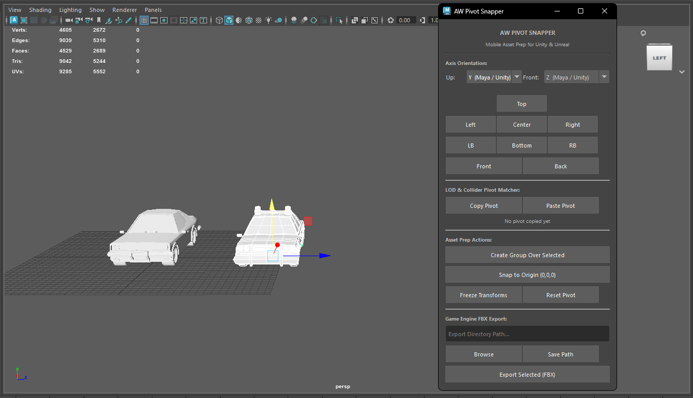

# 🎯 AW Pivot Snapper



*A clean, lightweight Autodesk Maya Python tool for fast bounding-box pivot snapping, LOD/collider pivot matching, and 1-click batch FBX exporting.*

---

## ✨ Why I Made This
When doing prop passes on lots of assets for mobile games, constantly centering pivots, snapping them to the floor or corners, zeroing transforms, and exporting one by one took way too many repetitive clicks.

I initially built this tool for Unity (Y-Up) to quickly snap asset pivots to the floor and export clean FBX files. Later on, I added dynamic axis orientation settings so if I ever need to prep assets for Unreal Engine (Z-Up), it works seamlessly without changing anything.

---

## 🚀 Key Features

- **Directional Bounding Box Snapping**: 1-Click snap to Floor (`Bottom`), `Center`, `Top`, `Left`, `Right`, `Front`, `Back`, and bottom corners (`LB`, `RB`).
- **Dynamic Axis Orientation**: Configurable **Up** (Y / Z / X) and **Front** (Z / X / Y) dropdowns to support both **Unity (Y-Up)** and **Unreal Engine (Z-Up)** workflows.
- **LOD & Collider Pivot Matcher**: 1-Click `Copy Pivot` from your base mesh and `Paste Pivot` directly onto LODs and collision hulls (`UCX_`).
- **Scene Prep Utilities**: 
  - `Create Group Over Selected`: Groups all selected assets into one clean parent group with an auto-centered pivot.
  - `Snap to Origin (0,0,0)`: Moves props so their pivot rests at world origin.
  - `Freeze Transforms` & `Reset Pivot`.
- **Batch FBX Exporter**: Specify your project export directory once, click `Save Path` (stored in Maya preferences), and batch export every selected asset with 1 click.

---

## 🧭 How To Run in Maya

### Option A: Run via Maya Script Editor (Easiest)
1. Download or copy `aw_pivot_snapper.py`.
2. Open Autodesk Maya and open the **Script Editor** (**Windows → General Editors → Script Editor**).
3. Switch to a **Python** tab, paste the code, and hit **Execute** (or `Ctrl + Enter`).

### Option B: Add to Maya Shelf
1. Place `aw_pivot_snapper.py` into your Maya scripts folder:
   - **Windows**: `Documents/maya/scripts/`
   - **macOS**: `~/Library/Preferences/Autodesk/maya/scripts/`
2. In Maya's Script Editor (Python tab), run:
```python
import aw_pivot_snapper
aw_pivot_snapper.show_ui()
```
3. Highlight that code and drag it onto your **Custom** shelf to make a 1-click shelf button!

---

## 🛠️ Requirements
- Autodesk Maya 2022+ (Python 3)
- Built-in `fbxmaya` plugin (auto-loaded by the tool during export)

---

## 🧑‍💻 Author
**Ashwath Jain**  
Technical Artist & Tool Developer  

- 🌐 [Portfolio](https://ashwathjain.github.io/portfolio/)  
- 💼 [LinkedIn](https://www.linkedin.com/in/ashwath-jain-54172b234/)  
- 🎨 [ArtStation](https://www.artstation.com/ryzenpp)  
- 🐙 [GitHub](https://github.com/ashwathjain)

---

## 📄 License
MIT License. Free to use in personal and commercial projects.
